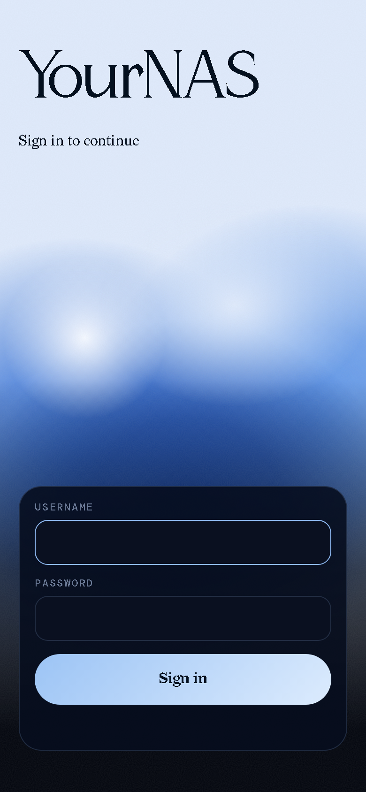
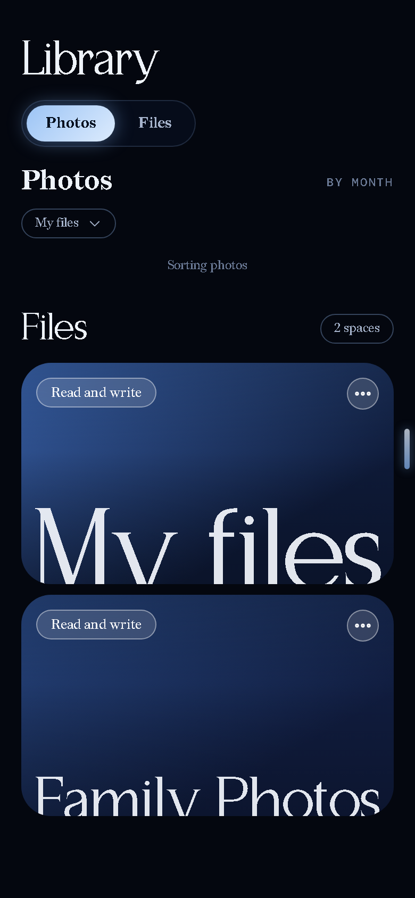
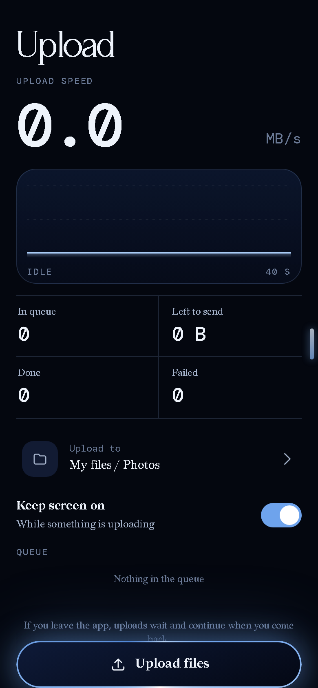
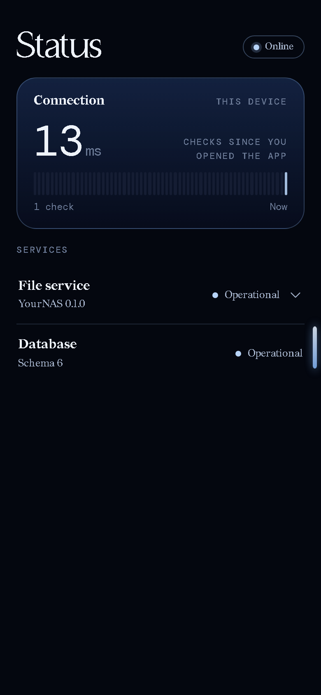
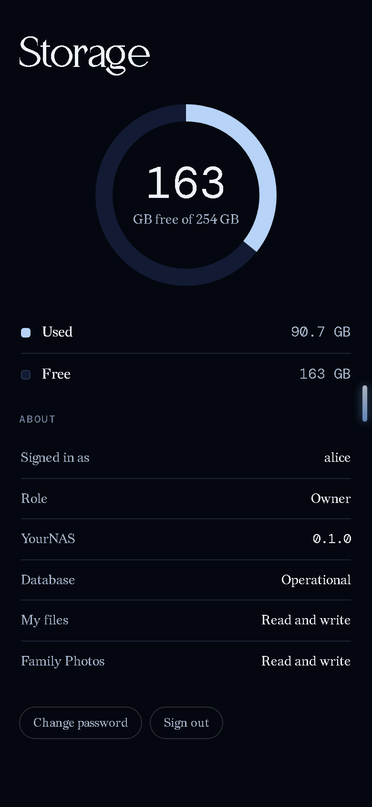

# YourNAS

A small, self-hosted private file server for one owner and a few trusted friends. It runs on an ordinary Windows machine (Python/FastAPI, local NTFS storage). It is reached only over a private [Tailscale](https://tailscale.com) network and used from an installable web app on iPhone, Android or desktop.

<p align="center">
  
  
  
</p>
<p align="center">
  
  
  
</p>

> **Not a backup.** If a file exists only on the server's disk, a disk failure can destroy it for good.

## Features

- **Private by design:** the server listens on `127.0.0.1` only. Remote access goes through `tailscale serve` (HTTPS, tailnet only, never Funnel). Nothing is exposed to the LAN or the internet.
- **Accounts:** one owner, created on the server console; friend accounts are created by the owner with a one-time temporary password that must be changed at first login. Argon2id hashes, login throttling, sliding and absolute session limits.
- **Files:** each user has a private space; the owner can create shared folders and grant `read` or `write` per friend. Default-deny authorization, strict path validation, audit log for shared folders.
- **Resumable uploads:** chunked uploads survive a dropped connection or a server restart, with live speed and queue in the app.
- **Photo library:** photos grouped by month, with thumbnails.
- **Web app (PWA):** add it to the iPhone home screen from Safari (Share → Add to Home Screen) or install it from Chrome on Android. A "keep screen on" option keeps the screen awake while files upload.
- **Runs unattended:** install script for a boot-time scheduled task under a dedicated low-privilege account, with restart-on-crash.

## Requirements

- Windows 10/11 with a local NTFS drive for the storage root
- Python 3.12
- Tailscale, for remote access

## Quick start (development)

```powershell
cd server
py -3.12 -m venv .venv
.\.venv\Scripts\python -m pip install -e ".[dev]"

# The storage root must be an existing folder on a local NTFS drive (not a system folder).
$env:YOURNAS_STORAGE_ROOT = "C:\YourNAS-Data"

# Create the owner account (password typed at a hidden prompt; there is no HTTP sign-up).
.\.venv\Scripts\python -m yournas create-owner --username alice

.\.venv\Scripts\python -m yournas        # http://127.0.0.1:8000/app/
```

Settings come from `YOURNAS_*` environment variables or a JSON file named by `YOURNAS_CONFIG`. See [`server/.env.example`](server/.env.example) and [`server/config.example.json`](server/config.example.json). The server refuses to start (exit code 2) if the configuration or the storage root is unsafe.

## Install on the server machine

Read the script first, then run it from an **elevated** PowerShell (`-DryRun` shows every step and changes nothing):

```powershell
powershell -NoProfile -ExecutionPolicy Bypass -File C:\YourNAS\server\scripts\install-yournas.ps1
```

It creates a venv, runs the tests, and then asks before each system change. These are: a service account, NTFS permissions on the storage root, the owner account, a boot-time scheduled task, and power settings so the machine stays awake while plugged in. It never touches the firewall, Tailscale or SMB.

Then publish the app on your tailnet with Tailscale Serve (HTTPS, tailnet only, never Funnel). Add the machine's MagicDNS name to `allowed_hosts`. Open `https://<machine>.<tailnet>.ts.net/app/` on your phone.

Manage friends and shared folders from the server console:

```powershell
.\server\scripts\nas-admin.ps1 add-user bob          # prints a one-time temporary password
.\server\scripts\nas-admin.ps1 add-share "Family Photos"
.\server\scripts\nas-admin.ps1 grant "Family Photos" bob read
```

Friends join by installing Tailscale and accepting the machine you share with them.

## Tests

```powershell
cd server
.\.venv\Scripts\python -m pytest
.\.venv\Scripts\python -m ruff check .
.\.venv\Scripts\python -m mypy
```

## Known limitations

- iOS pauses a web app a few seconds after the screen locks, so keep the screen on while uploading. An interrupted upload resumes on the server, but the app's queue is lost if the page is reloaded.
- In-app downloads are limited to 512 MiB.
- No native iOS app yet. Building one needs a Mac and the Apple Developer Program; see the roadmap.

## Documentation

- [Architecture](docs/ARCHITECTURE.md)
- [Security model](docs/SECURITY.md)
- [HTTP API](docs/API.md)
- [Design notes: photos, thumbnails, iOS Safari](docs/DESIGN-NOTES.md)
- [Roadmap](docs/ROADMAP.md)
